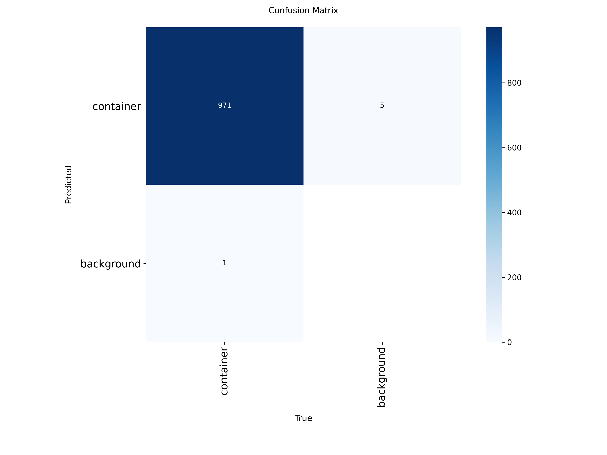

# Container Detector Training Report — 169c4626

- **Run ID:** `169c46265ca64ccbb6dee0c32802bf88`
- **Status:** completed
- **Started:** 2026-10-30T02:16:21.754702+00:00
- **Finished:** 2026-10-30T13:42:48.798582+00:00
- **Duration:** 41,187 seconds (11.44 hours)
- **Model:** yolo26n.pt; image size 640 px; batch 4; 50 epochs; CPU
- **Initialization:** resumed from run `64e28cbd861f4e26a04c83c8ecdb17a6` at epoch 46
- **Dataset fingerprint:** `65207b658d920430eaa1cb1f23397e7dfc3725d890fa7b99f23deb99b3fd1be0`

## Held-out test results

| Metric | Value |
|---|---:|
| `metrics/precision(B)` | 0.999849 |
| `metrics/recall(B)` | 0.998969 |
| `metrics/mAP50(B)` | 0.995000 |
| `metrics/mAP50-95(B)` | 0.942629 |
| `fitness` | 0.942629 |

## Best validation checkpoint

- **Best epoch:** 48
- **Best fitness:** 0.93751
- **Selection rule:** Ultralytics trainer.best_fitness / trainer.fitness

| Metric | Value |
|---|---:|
| `train/box_loss` | 0.3353 |
| `train/cls_loss` | 0.10342 |
| `train/dfl_loss` | 0.0039 |
| `metrics/precision(B)` | 1 |
| `metrics/recall(B)` | 0.99894 |
| `metrics/mAP50(B)` | 0.995 |
| `metrics/mAP50-95(B)` | 0.93751 |
| `val/box_loss` | 0.38263 |
| `val/cls_loss` | 0.11594 |
| `val/dfl_loss` | 0.01122 |
| `lr/pg0` | 0.0004164 |
| `lr/pg1` | 0.0001388 |
| `lr/pg2` | 0.0004164 |
| `lr/pg3` | 0.0001388 |
| `lr/pg4` | 0.0004164 |
| `lr/pg5` | 0.0001388 |
| `lr/pg6` | 0.0004164 |
| `lr/pg7` | 0.0001388 |

## Confusion matrix

Generated by the run’s final held-out test evaluation (967 images). Rows are predicted classes; columns are true classes. The matrix includes the detector background row/column.

[Download full resolution confusion matrix](container-detector-169c4626-confusion-matrix.png) · [Normalized matrix](container-detector-169c4626-confusion-matrix-normalized.png)

Matrix counts: 971 container true positives, 5 background false positives, 1 missed container (background prediction). No background-only true negatives are shown by the detector matrix.

## Dataset and split diagnostics

| Item | Value |
|---|---:|
| Source images | 9712 |
| Valid label files | 9670 |
| Invalid label files skipped | 42 |
| Missing label files | 0 |
| Empty label files | 0 |
| Valid boxes | 9694 |
| Train images | 7736 |
| Validation images | 967 |
| Test images | 967 |
| Skipped images | 42 |
| Split seed | 42 |
| Cross-split source groups | 0 |
| Split leakage check | True |

42 invalid label files were excluded for out-of-range YOLO boxes. Exact duplicate-image hashing was not run, as noted in the dataset diagnostic.

## Training performance and epoch history

The table reproduces every numeric column from the run’s raw `results.csv`. Epochs 1–45 were inherited from the resumed parent training state; epochs 46–50 were completed in this run.

| epoch | time | train/box_loss | train/cls_loss | train/dfl_loss | metrics/precision(B) | metrics/recall(B) | metrics/mAP50(B) | metrics/mAP50-95(B) | val/box_loss | val/cls_loss | val/dfl_loss | lr/pg0 | lr/pg1 | lr/pg2 | lr/pg3 | lr/pg4 | lr/pg5 | lr/pg6 | lr/pg7 |
|---|---|---|---|---|---|---|---|---|---|---|---|---|---|---|---|---|---|---|---|
| 1 | 10784.8 | 0.44843 | 0.1654 | 0.00414 | 0.99929 | 0.99794 | 0.995 | 0.92384 | 0.41508 | 0.12229 | 0.0123 | 0.00199897 | 0.000666322 | 0.00199897 | 0.000666322 | 0.00199897 | 0.000666322 | 0.00199897 | 0.000666322 |
| 2 | 18351.5 | 0.44525 | 0.16355 | 0.0042 | 0.99589 | 0.99787 | 0.995 | 0.92253 | 0.42709 | 0.12592 | 0.01266 | 0.00391979 | 0.0013066 | 0.00391979 | 0.0013066 | 0.00391979 | 0.0013066 | 0.00391979 | 0.0013066 |
| 3 | 25427 | 0.45302 | 0.17228 | 0.00431 | 0.99881 | 0.99486 | 0.995 | 0.92222 | 0.41452 | 0.1243 | 0.01227 | 0.00576141 | 0.00192047 | 0.00576141 | 0.00192047 | 0.00576141 | 0.00192047 | 0.00576141 | 0.00192047 |
| 4 | 32362.4 | 0.45478 | 0.17211 | 0.00442 | 0.99685 | 0.99794 | 0.995 | 0.89688 | 0.47051 | 0.13911 | 0.01397 | 0.0056436 | 0.0018812 | 0.0056436 | 0.0018812 | 0.0056436 | 0.0018812 | 0.0056436 | 0.0018812 |
| 5 | 39307.1 | 0.45833 | 0.17468 | 0.00442 | 0.9928 | 0.9932 | 0.99494 | 0.91936 | 0.41615 | 0.13132 | 0.01228 | 0.0055248 | 0.0018416 | 0.0055248 | 0.0018416 | 0.0055248 | 0.0018416 | 0.0055248 | 0.0018416 |
| 6 | 46249.6 | 0.45502 | 0.17226 | 0.00441 | 0.99794 | 0.9967 | 0.995 | 0.92395 | 0.41218 | 0.12272 | 0.01215 | 0.005406 | 0.001802 | 0.005406 | 0.001802 | 0.005406 | 0.001802 | 0.005406 | 0.001802 |
| 7 | 53254 | 0.44825 | 0.16975 | 0.00427 | 0.99838 | 0.9928 | 0.995 | 0.91842 | 0.41478 | 0.12897 | 0.01221 | 0.0052872 | 0.0017624 | 0.0052872 | 0.0017624 | 0.0052872 | 0.0017624 | 0.0052872 | 0.0017624 |
| 8 | 6614.54 | 0.44556 | 0.17127 | 0.00425 | 0.99658 | 0.99486 | 0.99498 | 0.92885 | 0.40045 | 0.12517 | 0.01177 | 0.0051684 | 0.0017228 | 0.0051684 | 0.0017228 | 0.0051684 | 0.0017228 | 0.0051684 | 0.0017228 |
| 9 | 13604.2 | 0.44156 | 0.16508 | 0.0042 | 0.99585 | 0.9869 | 0.99492 | 0.9279 | 0.40391 | 0.13324 | 0.01193 | 0.0050496 | 0.0016832 | 0.0050496 | 0.0016832 | 0.0050496 | 0.0016832 | 0.0050496 | 0.0016832 |
| 10 | 20661.6 | 0.4385 | 0.16373 | 0.00417 | 0.99691 | 0.99442 | 0.995 | 0.92466 | 0.40542 | 0.12936 | 0.01193 | 0.0049308 | 0.0016436 | 0.0049308 | 0.0016436 | 0.0049308 | 0.0016436 | 0.0049308 | 0.0016436 |
| 11 | 27827.3 | 0.43537 | 0.16236 | 0.00415 | 0.99284 | 0.99838 | 0.99497 | 0.91455 | 0.42518 | 0.13485 | 0.01253 | 0.004812 | 0.001604 | 0.004812 | 0.001604 | 0.004812 | 0.001604 | 0.004812 | 0.001604 |
| 12 | 34888.2 | 0.43237 | 0.15975 | 0.00407 | 0.99589 | 0.99594 | 0.99499 | 0.92118 | 0.41591 | 0.13166 | 0.01226 | 0.0046932 | 0.0015644 | 0.0046932 | 0.0015644 | 0.0046932 | 0.0015644 | 0.0046932 | 0.0015644 |
| 13 | 41713.3 | 0.42861 | 0.15827 | 0.00405 | 0.99832 | 0.99588 | 0.995 | 0.91893 | 0.41395 | 0.12765 | 0.01218 | 0.0045744 | 0.0015248 | 0.0045744 | 0.0015248 | 0.0045744 | 0.0015248 | 0.0045744 | 0.0015248 |
| 14 | 48545.5 | 0.43149 | 0.16054 | 0.00404 | 0.99486 | 0.99592 | 0.99499 | 0.92618 | 0.3933 | 0.12344 | 0.01155 | 0.0044556 | 0.0014852 | 0.0044556 | 0.0014852 | 0.0044556 | 0.0014852 | 0.0044556 | 0.0014852 |
| 15 | 55286.6 | 0.42638 | 0.15724 | 0.00402 | 0.99692 | 0.99767 | 0.99499 | 0.92183 | 0.39743 | 0.12402 | 0.01166 | 0.0043368 | 0.0014456 | 0.0043368 | 0.0014456 | 0.0043368 | 0.0014456 | 0.0043368 | 0.0014456 |
| 16 | 61903.3 | 0.4252 | 0.15655 | 0.004 | 0.99487 | 0.99671 | 0.99499 | 0.93084 | 0.38988 | 0.1253 | 0.01145 | 0.004218 | 0.001406 | 0.004218 | 0.001406 | 0.004218 | 0.001406 | 0.004218 | 0.001406 |
| 17 | 68746.6 | 0.42586 | 0.15482 | 0.00397 | 0.99858 | 0.99897 | 0.995 | 0.93423 | 0.38559 | 0.11665 | 0.01129 | 0.0040992 | 0.0013664 | 0.0040992 | 0.0013664 | 0.0040992 | 0.0013664 | 0.0040992 | 0.0013664 |
| 18 | 75593.7 | 0.41898 | 0.15637 | 0.00398 | 0.99485 | 0.99331 | 0.99495 | 0.92776 | 0.3964 | 0.12884 | 0.01163 | 0.0039804 | 0.0013268 | 0.0039804 | 0.0013268 | 0.0039804 | 0.0013268 | 0.0039804 | 0.0013268 |
| 19 | 82487.4 | 0.41895 | 0.15593 | 0.00398 | 0.99731 | 0.99177 | 0.99498 | 0.93136 | 0.38961 | 0.12561 | 0.01144 | 0.0038616 | 0.0012872 | 0.0038616 | 0.0012872 | 0.0038616 | 0.0012872 | 0.0038616 | 0.0012872 |
| 20 | 89456.4 | 0.41899 | 0.15666 | 0.00397 | 0.99794 | 0.99576 | 0.99499 | 0.9276 | 0.38385 | 0.12425 | 0.01126 | 0.0037428 | 0.0012476 | 0.0037428 | 0.0012476 | 0.0037428 | 0.0012476 | 0.0037428 | 0.0012476 |
| 21 | 96690.2 | 0.41464 | 0.15315 | 0.00388 | 0.99792 | 0.99074 | 0.99498 | 0.93391 | 0.38486 | 0.12428 | 0.01125 | 0.003624 | 0.001208 | 0.003624 | 0.001208 | 0.003624 | 0.001208 | 0.003624 | 0.001208 |
| 22 | 103712 | 0.41546 | 0.14963 | 0.00388 | 0.99793 | 0.99135 | 0.99498 | 0.92388 | 0.39171 | 0.1323 | 0.01149 | 0.0035052 | 0.0011684 | 0.0035052 | 0.0011684 | 0.0035052 | 0.0011684 | 0.0035052 | 0.0011684 |
| 23 | 110937 | 0.41338 | 0.15232 | 0.00385 | 0.99384 | 0.99616 | 0.99497 | 0.93187 | 0.38404 | 0.12494 | 0.01128 | 0.0033864 | 0.0011288 | 0.0033864 | 0.0011288 | 0.0033864 | 0.0011288 | 0.0033864 | 0.0011288 |
| 24 | 117961 | 0.41382 | 0.14963 | 0.00387 | 0.99467 | 0.99897 | 0.99498 | 0.92936 | 0.38899 | 0.12307 | 0.01145 | 0.0032676 | 0.0010892 | 0.0032676 | 0.0010892 | 0.0032676 | 0.0010892 | 0.0032676 | 0.0010892 |
| 25 | 124549 | 0.41513 | 0.15453 | 0.00387 | 0.99651 | 0.99588 | 0.99496 | 0.92745 | 0.38146 | 0.12534 | 0.01116 | 0.0031488 | 0.0010496 | 0.0031488 | 0.0010496 | 0.0031488 | 0.0010496 | 0.0031488 | 0.0010496 |
| 26 | 131148 | 0.41263 | 0.16057 | 0.00384 | 0.99633 | 0.99486 | 0.99499 | 0.93462 | 0.37635 | 0.12408 | 0.01106 | 0.00303 | 0.00101 | 0.00303 | 0.00101 | 0.00303 | 0.00101 | 0.00303 | 0.00101 |
| 27 | 137693 | 0.40752 | 0.15697 | 0.00382 | 0.99587 | 0.99325 | 0.99499 | 0.92889 | 0.3854 | 0.12757 | 0.01133 | 0.0029112 | 0.0009704 | 0.0029112 | 0.0009704 | 0.0029112 | 0.0009704 | 0.0029112 | 0.0009704 |
| 28 | 144225 | 0.40739 | 0.15031 | 0.00377 | 0.99781 | 0.99588 | 0.995 | 0.93131 | 0.37836 | 0.12043 | 0.01111 | 0.0027924 | 0.0009308 | 0.0027924 | 0.0009308 | 0.0027924 | 0.0009308 | 0.0027924 | 0.0009308 |
| 29 | 150772 | 0.40943 | 0.15274 | 0.00379 | 0.99963 | 0.99383 | 0.995 | 0.93274 | 0.37834 | 0.1236 | 0.0111 | 0.0026736 | 0.0008912 | 0.0026736 | 0.0008912 | 0.0026736 | 0.0008912 | 0.0026736 | 0.0008912 |
| 30 | 157284 | 0.40439 | 0.15169 | 0.00378 | 0.99586 | 0.99092 | 0.99497 | 0.92723 | 0.38827 | 0.13055 | 0.0114 | 0.0025548 | 0.0008516 | 0.0025548 | 0.0008516 | 0.0025548 | 0.0008516 | 0.0025548 | 0.0008516 |
| 31 | 163863 | 0.40093 | 0.15075 | 0.00372 | 0.99948 | 0.99588 | 0.995 | 0.9328 | 0.3778 | 0.12041 | 0.01107 | 0.002436 | 0.000812 | 0.002436 | 0.000812 | 0.002436 | 0.000812 | 0.002436 | 0.000812 |
| 32 | 170504 | 0.40122 | 0.14535 | 0.00375 | 0.99722 | 0.99794 | 0.995 | 0.93302 | 0.38811 | 0.12012 | 0.01138 | 0.0023172 | 0.0007724 | 0.0023172 | 0.0007724 | 0.0023172 | 0.0007724 | 0.0023172 | 0.0007724 |
| 33 | 177496 | 0.40001 | 0.14763 | 0.00371 | 0.99794 | 0.99673 | 0.995 | 0.93285 | 0.38717 | 0.12101 | 0.01135 | 0.0021984 | 0.0007328 | 0.0021984 | 0.0007328 | 0.0021984 | 0.0007328 | 0.0021984 | 0.0007328 |
| 34 | 184335 | 0.39682 | 0.14218 | 0.00369 | 0.99794 | 0.99884 | 0.995 | 0.93397 | 0.38196 | 0.11766 | 0.01119 | 0.0020796 | 0.0006932 | 0.0020796 | 0.0006932 | 0.0020796 | 0.0006932 | 0.0020796 | 0.0006932 |
| 35 | 191183 | 0.39475 | 0.14277 | 0.00366 | 0.99692 | 0.99752 | 0.99499 | 0.93443 | 0.38025 | 0.11907 | 0.01114 | 0.0019608 | 0.0006536 | 0.0019608 | 0.0006536 | 0.0019608 | 0.0006536 | 0.0019608 | 0.0006536 |
| 36 | 198513 | 0.39402 | 0.14046 | 0.00362 | 0.99384 | 0.99594 | 0.99497 | 0.93646 | 0.37881 | 0.11983 | 0.01109 | 0.001842 | 0.000614 | 0.001842 | 0.000614 | 0.001842 | 0.000614 | 0.001842 | 0.000614 |
| 37 | 205644 | 0.39384 | 0.14119 | 0.00363 | 0.99911 | 0.99897 | 0.995 | 0.93341 | 0.38537 | 0.11346 | 0.01131 | 0.0017232 | 0.0005744 | 0.0017232 | 0.0005744 | 0.0017232 | 0.0005744 | 0.0017232 | 0.0005744 |
| 38 | 212367 | 0.39308 | 0.14103 | 0.00362 | 0.9998 | 0.99794 | 0.995 | 0.93319 | 0.38254 | 0.11441 | 0.01123 | 0.0016044 | 0.0005348 | 0.0016044 | 0.0005348 | 0.0016044 | 0.0005348 | 0.0016044 | 0.0005348 |
| 39 | 218966 | 0.39179 | 0.14132 | 0.00362 | 0.99897 | 0.99892 | 0.995 | 0.93556 | 0.38047 | 0.11574 | 0.01116 | 0.0014856 | 0.0004952 | 0.0014856 | 0.0004952 | 0.0014856 | 0.0004952 | 0.0014856 | 0.0004952 |
| 40 | 225557 | 0.3871 | 0.1364 | 0.00358 | 1 | 0.99775 | 0.995 | 0.93507 | 0.37971 | 0.11639 | 0.01114 | 0.0013668 | 0.0004556 | 0.0013668 | 0.0004556 | 0.0013668 | 0.0004556 | 0.0013668 | 0.0004556 |
| 41 | 232062 | 0.35509 | 0.10973 | 0.00412 | 1 | 0.99547 | 0.995 | 0.93451 | 0.38492 | 0.11723 | 0.01128 | 0.001248 | 0.000416 | 0.001248 | 0.000416 | 0.001248 | 0.000416 | 0.001248 | 0.000416 |
| 42 | 238513 | 0.35205 | 0.10786 | 0.00408 | 1 | 0.99673 | 0.995 | 0.93416 | 0.38512 | 0.11756 | 0.01127 | 0.0011292 | 0.0003764 | 0.0011292 | 0.0003764 | 0.0011292 | 0.0003764 | 0.0011292 | 0.0003764 |
| 43 | 245031 | 0.3501 | 0.10687 | 0.00406 | 1 | 0.99766 | 0.995 | 0.93686 | 0.37985 | 0.11422 | 0.01113 | 0.0010104 | 0.0003368 | 0.0010104 | 0.0003368 | 0.0010104 | 0.0003368 | 0.0010104 | 0.0003368 |
| 44 | 251542 | 0.34805 | 0.1062 | 0.00403 | 0.99879 | 0.99691 | 0.995 | 0.93651 | 0.38506 | 0.11659 | 0.01129 | 0.0008916 | 0.0002972 | 0.0008916 | 0.0002972 | 0.0008916 | 0.0002972 | 0.0008916 | 0.0002972 |
| 45 | 258140 | 0.34539 | 0.10491 | 0.004 | 0.99897 | 0.99773 | 0.995 | 0.93509 | 0.38012 | 0.11572 | 0.01114 | 0.0007728 | 0.0002576 | 0.0007728 | 0.0002576 | 0.0007728 | 0.0002576 | 0.0007728 | 0.0002576 |
| 46 | 8199.78 | 0.33946 | 0.10315 | 0.00392 | 0.99817 | 0.99691 | 0.995 | 0.93563 | 0.38216 | 0.11674 | 0.0112 | 0.000654 | 0.000218 | 0.000654 | 0.000218 | 0.000654 | 0.000218 | 0.000654 | 0.000218 |
| 47 | 16227.4 | 0.33867 | 0.10368 | 0.00388 | 0.99876 | 0.99897 | 0.995 | 0.93549 | 0.38373 | 0.11467 | 0.01125 | 0.0005352 | 0.0001784 | 0.0005352 | 0.0001784 | 0.0005352 | 0.0001784 | 0.0005352 | 0.0001784 |
| 48 | 24432.1 | 0.3353 | 0.10342 | 0.0039 | 1 | 0.99894 | 0.995 | 0.93751 | 0.38263 | 0.11594 | 0.01122 | 0.0004164 | 0.0001388 | 0.0004164 | 0.0001388 | 0.0004164 | 0.0001388 | 0.0004164 | 0.0001388 |
| 49 | 32688.6 | 0.33399 | 0.10172 | 0.00386 | 0.99882 | 0.99691 | 0.995 | 0.93561 | 0.38177 | 0.11623 | 0.01119 | 0.0002976 | 9.92e-05 | 0.0002976 | 9.92e-05 | 0.0002976 | 9.92e-05 | 0.0002976 | 9.92e-05 |
| 50 | 40585.6 | 0.33248 | 0.10149 | 0.00382 | 0.99692 | 0.99857 | 0.995 | 0.93613 | 0.381 | 0.11615 | 0.01116 | 0.0001788 | 5.96e-05 | 0.0001788 | 5.96e-05 | 0.0001788 | 5.96e-05 | 0.0001788 | 5.96e-05 |

## Run settings

| Setting | Value |
|---|---|
| `task` | `"detect"` |
| `mode` | `"train"` |
| `model` | `"/runs/jobs/a8ac42ced72f4286a5afc5618127f8a8/results/container/weights/last.pt"` |
| `data` | `"/runs/jobs/a8ac42ced72f4286a5afc5618127f8a8/dataset/data.yaml"` |
| `epochs` | `50` |
| `time` | `null` |
| `patience` | `20` |
| `batch` | `4` |
| `imgsz` | `640` |
| `save` | `true` |
| `save_period` | `-1` |
| `cache` | `false` |
| `device` | `"cpu"` |
| `workers` | `0` |
| `project` | `"/runs/jobs/a8ac42ced72f4286a5afc5618127f8a8/results"` |
| `name` | `"container"` |
| `exist_ok` | `true` |
| `pretrained` | `true` |
| `optimizer` | `"auto"` |
| `verbose` | `true` |
| `seed` | `0` |
| `deterministic` | `true` |
| `single_cls` | `false` |
| `rect` | `false` |
| `cos_lr` | `false` |
| `close_mosaic` | `10` |
| `resume` | `"/runs/jobs/a8ac42ced72f4286a5afc5618127f8a8/results/container/weights/last.pt"` |
| `amp` | `false` |
| `fraction` | `1.0` |
| `profile` | `false` |
| `freeze` | `null` |
| `multi_scale` | `0.0` |
| `compile` | `false` |
| `overlap_mask` | `true` |
| `mask_ratio` | `4` |
| `dropout` | `0.0` |
| `val` | `true` |
| `split` | `"val"` |
| `save_json` | `false` |
| `conf` | `null` |
| `iou` | `0.7` |
| `max_det` | `300` |
| `half` | `false` |
| `dnn` | `false` |
| `plots` | `true` |
| `source` | `null` |
| `vid_stride` | `1` |
| `stream_buffer` | `false` |
| `visualize` | `false` |
| `augment` | `false` |
| `agnostic_nms` | `false` |
| `classes` | `null` |
| `retina_masks` | `false` |
| `embed` | `null` |
| `show` | `false` |
| `save_frames` | `false` |
| `save_txt` | `false` |
| `save_conf` | `false` |
| `save_crop` | `false` |
| `show_labels` | `true` |
| `show_conf` | `true` |
| `show_boxes` | `true` |
| `line_width` | `null` |
| `format` | `"torchscript"` |
| `keras` | `false` |
| `optimize` | `false` |
| `int8` | `false` |
| `dynamic` | `false` |
| `simplify` | `true` |
| `opset` | `null` |
| `workspace` | `null` |
| `nms` | `false` |
| `lr0` | `0.01` |
| `lrf` | `0.01` |
| `momentum` | `0.937` |
| `weight_decay` | `0.0005` |
| `warmup_epochs` | `3.0` |
| `warmup_momentum` | `0.8` |
| `warmup_bias_lr` | `0.0` |
| `box` | `7.5` |
| `cls` | `0.5` |
| `dfl` | `1.5` |
| `pose` | `12.0` |
| `kobj` | `1.0` |
| `rle` | `1.0` |
| `angle` | `1.0` |
| `nbs` | `64` |
| `hsv_h` | `0.015` |
| `hsv_s` | `0.7` |
| `hsv_v` | `0.4` |
| `degrees` | `0.0` |
| `translate` | `0.1` |
| `scale` | `0.5` |
| `shear` | `0.0` |
| `perspective` | `0.0` |
| `flipud` | `0.0` |
| `fliplr` | `0.5` |
| `bgr` | `0.0` |
| `mosaic` | `1.0` |
| `mixup` | `0.0` |
| `cutmix` | `0.0` |
| `copy_paste` | `0.0` |
| `copy_paste_mode` | `"flip"` |
| `auto_augment` | `"randaugment"` |
| `erasing` | `0.4` |
| `cfg` | `null` |
| `tracker` | `"botsort.yaml"` |
| `save_dir` | `"/runs/jobs/a8ac42ced72f4286a5afc5618127f8a8/results/container"` |
| `initMode` | `"resume"` |
| `checkpointId` | `"64e28cbd861f4e26a04c83c8ecdb17a6-last"` |
| `splitCounts` | `{"train": 7736, "val": 967, "test": 967}` |
| `environment` | `{"python": "3.12.16", "platform": "Linux-5.15.0-191-generic-x86_64-with-glibc2.41", "torch": "2.7.1+cpu", "ultralytics": "8.4.0", "application": "1.0.0"}` |

## Resource and timing summary

| Statistic | Value |
|---|---:|
| Average epoch duration | 7,024.28 s |
| Recent 5-epoch average | 7,796.76 s |
| Recent completion rate | 0.462 epochs/hour |
| Peak recorded process CPU | 276.8 % |
| Memory limit/host-visible total | 16764948480 bytes |

## Provenance

- Epoch metrics: [`results.csv`](../runs/jobs/a8ac42ced72f4286a5afc5618127f8a8/results/container/results.csv)
- Run metadata: [`job.json`](../runs/jobs/169c46265ca64ccbb6dee0c32802bf88/job.json)
- Final test metrics and confusion matrix came from the completed held-out test evaluation.
- Epoch table values are read from `results.csv`; metrics are training/validation values, not test-split epoch scores.
